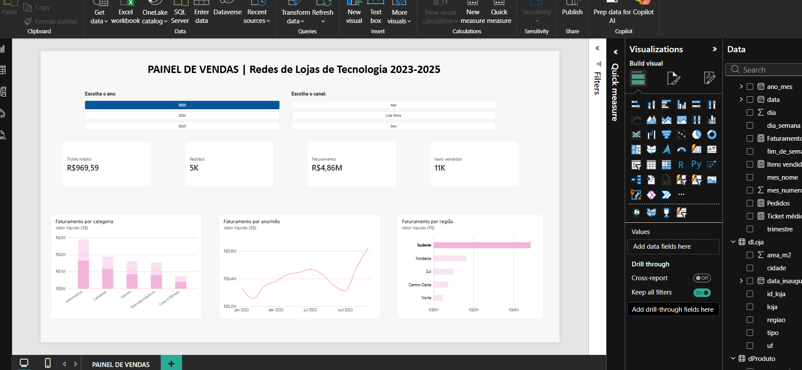

# Painel de Vendas | Rede de Lojas de Tecnologia 2023-2025

Painel em Power BI com o acompanhamento das vendas da rede.

## O que tem no painel
- Indicadores: Faturamento, Pedidos, Ticket médio e Itens vendidos
- Evolução do faturamento por mês
- Faturamento por categoria e por região
- Filtros por ano e canal

## Tabelas
fVendas, dProduto, dLoja e dCalendario

## Ferramentas
Power BI, Power Query e DAX
